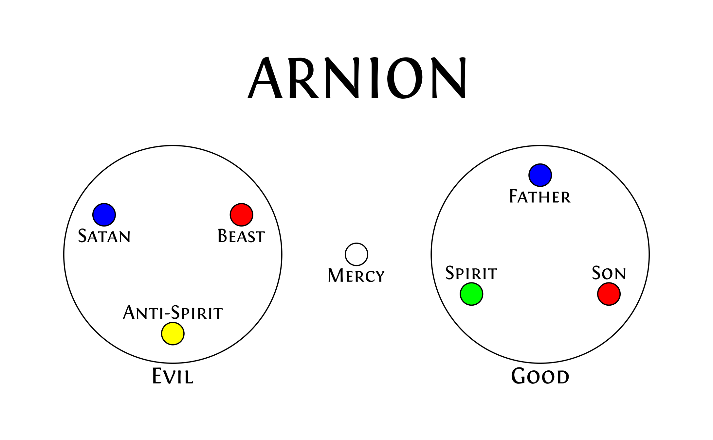

[Polski](pl/)

# The Arnion Model: A Symbolic Interpretation

Diagram and interpretation by Xaader.

This page presents the "Arnion" diagram and a symbolic reading of it. Particle physics is used here as a language of symbols, not as proof. The model asks for symbolic coherence, not physical precision.

## Central idea

**Evil is the default state of isolation. Good is a state that must be sustained in community and with a gift from outside.** Falling requires no action, while returning requires energy and a response to that gift.

## Elements of the model

### Right circle: Good (neutron, udd)

- The top/bottom arrangement matches the quark content: the Father at the top (u), the Son and the Spirit at the bottom (d).
- Red, green and blue combine into white: a closed, stable whole that does not draw attention. Good works in the background.
- The neutron is electrically neutral, symbolizing openness: it does not repel others.
- Intent: Good is the unity of three in relationship, not a sum of parts. The Trinity is not made of pieces, so this analogy has limits.

### Left circle: Evil (proton, uud)

- The arrangement is inverted: two dots at the top (Satan and the Beast), one at the bottom (the Anti-Spirit).
- Blue, red and yellow do not combine into white. Evil is unclosed and conspicuous, since color stands out. Hence the observation that people notice evil more easily than good.
- The proton is charged, so it repels. Evil is closure toward others.
- Intent: Evil has the same structure as Good, but distorted. It is a parody, not an equal opponent, so the diagram does not teach dualism.

### White dot: Mercy (electron)

- The electron is colorless and stands outside the colored play of Good and Evil. Neither circle contains it.
- Its charge is opposite to the proton's, so it can balance it (a proton with an electron is a neutral atom).
- Intent: Mercy is on neither side. It is a constant, external offer that does not cause the fall, but accompanies it or makes return possible.

## Dynamics

### The fall: n → p + e⁻ + antineutrino

- It happens spontaneously and effortlessly. Neglect is enough.
- It concerns a free, solitary neutron (about 15 minutes). Inside a nucleus, in community, the neutron is stable.
- The electron appears together with the fall: Mercy is present, but outside what has fallen.
- The antineutrino is a quiet trace of the fall that the world barely notices. Good is lost without fanfare.

### The return: p + e⁻ → n

- It does not occur spontaneously. It requires energy and an encounter with an electron.
- Symbolically: the offer alone is not enough, a response is needed. Energy from outside is grace, and accepting it is a free response.

### Energy gradient

Evil is movement downhill (no input needed), while Good is movement uphill (input needed). This fits sins of omission and the intuition that order requires work, while decay happens by itself.

## Theological framework

- **The eternity of hell** corresponds to the stability of the proton: Evil as a lasting state from which, without an inflow of energy, there is no return. This agrees with the Church's teaching on hell as definitive self-exclusion.
- **Evil as privation** (*privatio boni*) is expressed by the unclosed color: Evil lacks fullness because it does not resolve into white.
- **Grace and response**: the energy comes from outside the system, and the person receives it. The model is therefore neither mere effort (Pelagianism) nor grace without response.
- **Community**: Good is sustained in relationship (the nucleus), while solitude leads to decay.

## Limits of the model

- The fall here concerns **a creature participating in Good**, not God himself. The Trinity in the right circle is the source, while the neutron describes the state of a being.
- Beta decay has no free will, so "free choice" in the model is a symbolic layer, not a physical one.
- Colors, top/bottom arrangement and charge are **signs**, not literal equivalents.
